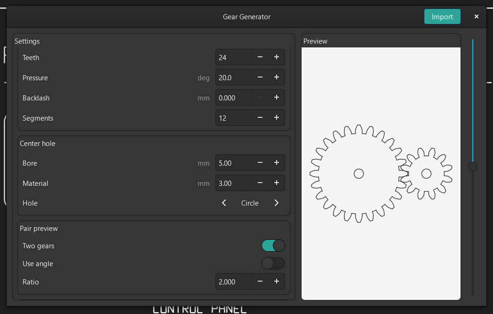
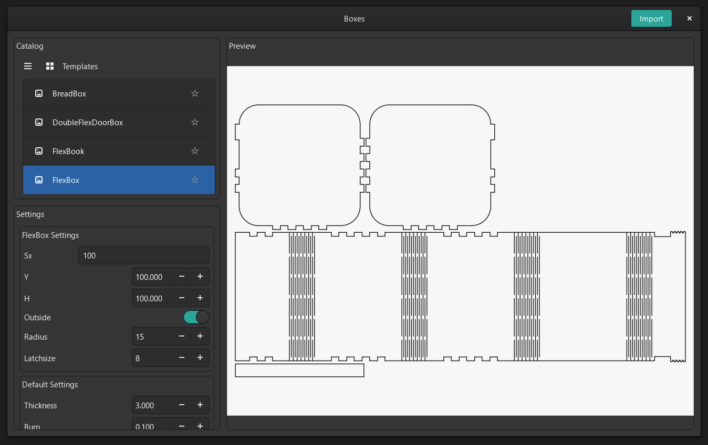
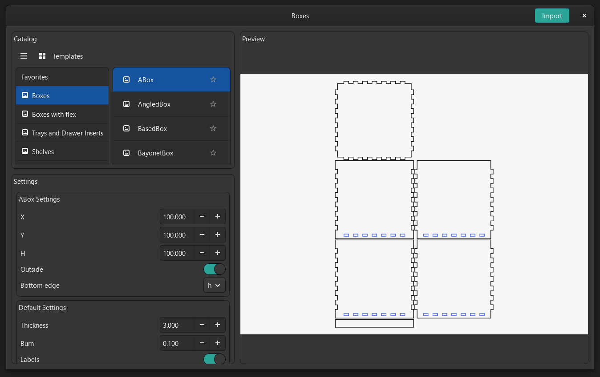

# DXF Sketcher

**Open a drawing. Make it yours. Get it ready for the workshop.**

A 2D drawing editor for laser-cut parts, templates, signs, control panels and everyday DXF cleanup. Draw and adjust precise geometry, generate useful parts, and export your work as DXF or SVG.

**[Download for Windows or Linux](#download)** · [See the tools in action](#tools-in-action) · [Try the sample drawings](#try-it-in-a-minute) · [Get help](#help-and-feedback)

*A real drawing in DXF Sketcher on Windows. [Open this sample yourself](examples/01-control-panel.dxf).*

## Download

Choose a ready-to-use package from **[the latest release](https://github.com/EriArk/-DXF-Sketcher/releases/latest)**. You do not need to build the app or install development tools.

| Your computer | Download · version 1.5.3 |
| --- | --- |
| Windows, 64-bit | [Windows installer (.msi)](https://github.com/EriArk/-DXF-Sketcher/releases/download/v1.5.3/dxfsketcher-1.5.3-x64.msi) |
| Ubuntu / Debian, 64-bit | [Debian package (.deb)](https://github.com/EriArk/-DXF-Sketcher/releases/download/v1.5.3/dxfsketcher_1.5.3_amd64.deb) |
| Fedora / RPM-based Linux, 64-bit | [RPM package (.rpm)](https://github.com/EriArk/-DXF-Sketcher/releases/download/v1.5.3/dxfsketcher-1.5.3-1.x86_64.rpm) |
| Other desktop Linux, 64-bit | [AppImage](https://github.com/EriArk/-DXF-Sketcher/releases/download/v1.5.3/dxfsketcher-1.5.3-x86_64.AppImage) |

On Windows, run the MSI and follow the installer. On Linux, open the package with your system's software installer; for AppImage, enable **Allow executing file as program** in its file properties, then launch it. There is no macOS download in the current release.

[Release notes and all downloads](https://github.com/EriArk/-DXF-Sketcher/releases)

## From a sketch to a set of parts

| When you want to… | DXF Sketcher helps you… |
| --- | --- |
| Fix an existing drawing | Open DXF, move or duplicate geometry, trim edges and redraw missing details. |
| Make a precise part | Draw lines, arcs, circles, rectangles, rounded rectangles, polygons and text; use snapping and constraints. |
| Design parts for fabrication | Add finger joints, grooves, hinges, lids, flex cuts and handles with **Edge Tools**. |
| Start with a useful template | Explore the bundled **Boxes** catalog, generate **Gears**, or use the **Cup Template** helper. |
| Turn artwork into outlines | Prepare a raster image, then trace it into editable vector geometry. |
| Keep a whole job together | Open folders, mark files with colors, control visibility and save a **.dxsp project**. |

Save drawings as **DXF**, or use **Save As** to export **SVG**. Sketcher focuses on 2D drawing and fabrication preparation; machine control and toolpath generation belong in your fabrication software.

## Tools in action

### Gears that mesh and move together

Create an involute gear, switch on **Two gears**, and set the **Ratio** to preview a meshing pair. Move the vertical rotation slider to turn both gears together and inspect their engagement before importing the geometry into your drawing.

*A real interactive preview recorded in Sketcher, with Ratio set to 2.000. The animation loops; in the app, you control the rotation. [View a still image](screenshots/showcase-2026-10/gear-pair-preview.png).*

Adjust the tooth count, module, pressure angle, backlash and center hole to suit your design. To try the pair shown here, right-click **Gears**, choose **Open Generator**, enable **Two gears**, and enter **2** for the ratio.

### Boxes, including flexible walls

Open **Boxes**, choose a template from the bundled catalog, and change its dimensions and material settings. The preview shows the flat parts that will be imported into your drawing.

*Choose **Boxes with flex → FlexBox** to explore a wall with repeated cuts for bending around the corners. This example uses the template's 100 mm dimensions, 15 mm radius and 3 mm material thickness.*

See a simpler box with finger joints

Choose **Boxes → ABox** for a straightforward starting point. The catalog also includes trays, drawer inserts, shelves and other workshop projects.

### Joints and edge treatments on your own shapes

Use **Edge Tools** when you already have an outline. Choose a joint family and operation, set the material thickness and burn allowance, then apply it to the selected edges. Finger joints are one example; the tool also offers grooves, hinges, lids, flex cuts and handles.

*Earlier Linux capture from March 2026, retained in its original form.*

### From a picture to editable outlines

Prepare artwork with **Import Raster**, then use **Trace Image** to compare the original image with its vector preview. Tune the threshold, smoothness and noise filtering before applying the result to your drawing.

*Earlier Linux capture from March 2026, retained in its original form.*

There is also a **Cup Template** helper for generating a flat template from cup dimensions. Combine generated parts with ordinary sketch geometry, text and imported artwork, then save as DXF or SVG.

## Try it in a minute

1. Install and launch DXF Sketcher.
2. Download the [control panel example](https://raw.githubusercontent.com/EriArk/-DXF-Sketcher/main/examples/01-control-panel.dxf) and choose **Open file** on the start screen.
3. Zoom with the mouse wheel to inspect the display opening, mounting holes and slots. Use the selection tool's **Show markers** option when you want to see geometry points.
4. Make an edit and use **Save As** to keep your own copy.

The [sample folder](examples) also contains a ventilation panel and a four-part enclosure layout. All three drawings are in millimetres and are free to reuse. They are illustrative designs; adapt dimensions, material and cutting allowances to your own build.

## A workspace that suits you

Choose **Light, Mix, Dark, Blue or Light-Blue**, adjust the accent and line thickness, and show drawing helpers when you need them. Short tool hints and toolbar popovers keep frequently used options close to the canvas.

For larger jobs, open a folder of DXF files. A **.dxsp** project copies the relevant files into a project folder and remembers the structure, active file, visibility and color markers, so you can return to the same job later.

The October screenshots and gear animation were captured from the installed Windows application on 4 October 2026; the two earlier Linux examples are labelled above. [Capture details](screenshots/showcase-2026-10/README.md). More earlier screenshots remain in [the screenshot archive](screenshots).

## DXF compatibility

Import currently supports lines, circles, arcs, polyline vertices and a limited cubic-spline form. Layer information and unsupported entities can be lost on import, and Bezier export approximates curves with line segments. Keep the original drawing, inspect the result and use **Save As** for edits to existing DXFs. [Import fidelity work](https://github.com/EriArk/-DXF-Sketcher/issues/2) and [curve export accuracy](https://github.com/EriArk/-DXF-Sketcher/issues/5) are tracked publicly.

## Sketcher or Viewer?

Use **Sketcher** to create or change drawings. If you mainly want to open DXF files, inspect details and check distances, try the smaller-purpose **[DXF Viewer / Viewer Plus](https://github.com/EriArk/-DXF-Viewer)**.

## Help and feedback

Use **Help** from the application menu, or [report a problem / suggest an improvement](https://github.com/EriArk/-DXF-Sketcher/issues). For drawing problems, include your operating system, app version and a small DXF that you can share publicly.

If Sketcher is useful in your workshop, you can support development on **[Patreon](https://patreon.com/AbyssTail)** or **[Ko-fi](https://ko-fi.com/abysstail)**.

## For developers

[Build from source and create packages](BUILDING.md) · [Contribute](CONTRIBUTING.md) · [Development guide](DEVELOPMENT.md) · [Report a security concern](SECURITY.md).

## Acknowledgements and license

DXF Sketcher builds on [dune3d](https://github.com/dune3d/dune3d) and the work of [SolveSpace](https://github.com/solvespace/solvespace), [boxes.py](https://boxes.hackerspace-bamberg.de/), [dxflib](https://www.ribbonsoft.com/dxflib.html), [Clipper2](http://www.angusj.com/clipper2/Docs/Overview.htm), [nlohmann/json](https://github.com/nlohmann/json) and [NanoSVG](https://github.com/memononen/nanosvg).

The application is licensed under **[GPL-3.0](LICENSE)**. Third-party components retain their own licenses in the 3rd_party folder.
