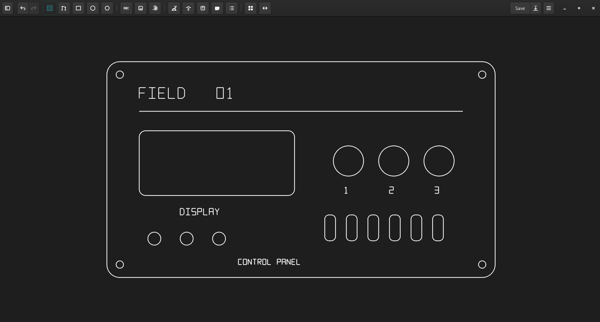
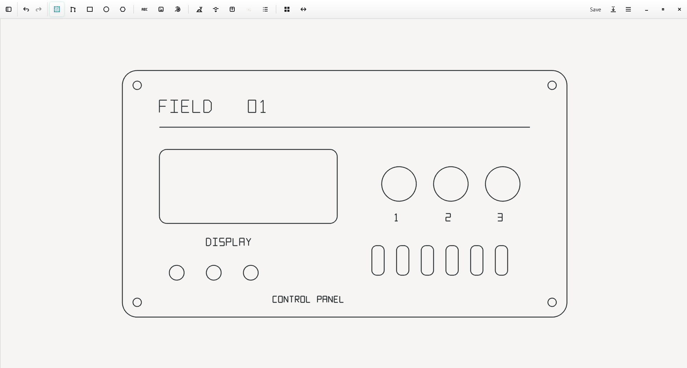

# DXF Sketcher

**Open a drawing. Make it yours. Get it ready for the workshop.**

A 2D drawing editor for laser-cut parts, templates, signs, control panels and everyday DXF cleanup. Draw and adjust precise geometry, generate useful parts, and export your work as DXF or SVG.

**[Download for Windows or Linux](#download)** · [Try the sample drawings](#try-it-in-a-minute) · [What you can make](#from-a-sketch-to-a-set-of-parts) · [Get help](#help-and-feedback)

*A real drawing in DXF Sketcher on Windows. [Open this sample yourself](examples/01-control-panel.dxf).*

## Download

Choose a ready-to-use package from **[the latest release](https://github.com/EriArk/-DXF-Sketcher/releases/latest)**. You do not need to build the app or install development tools.

| Your computer | Download · version 1.5.3 |
| --- | --- |
| Windows, 64-bit | [Windows installer (.msi)](https://github.com/EriArk/-DXF-Sketcher/releases/download/v1.5.3/dxfsketcher-1.5.3-x64.msi) |
| Ubuntu / Debian, 64-bit | [Debian package (.deb)](https://github.com/EriArk/-DXF-Sketcher/releases/download/v1.5.3/dxfsketcher_1.5.3_amd64.deb) |
| Fedora / RPM-based Linux, 64-bit | [RPM package (.rpm)](https://github.com/EriArk/-DXF-Sketcher/releases/download/v1.5.3/dxfsketcher-1.5.3-1.x86_64.rpm) |
| Other desktop Linux, 64-bit | [AppImage](https://github.com/EriArk/-DXF-Sketcher/releases/download/v1.5.3/dxfsketcher-1.5.3-x86_64.AppImage) |

On Windows, run the MSI and follow the installer. On Linux, open the package with your system's software installer; for AppImage, enable **Allow executing file as program** in its file properties, then launch it. There is no macOS download in the current release.

[Release notes and all downloads](https://github.com/EriArk/-DXF-Sketcher/releases)

## From a sketch to a set of parts

| When you want to… | DXF Sketcher helps you… |
| --- | --- |
| Fix an existing drawing | Open DXF, move or duplicate geometry, trim edges and redraw missing details. |
| Make a precise part | Draw lines, arcs, circles, rectangles, rounded rectangles, polygons and text; use snapping and constraints. |
| Design parts for fabrication | Add finger joints, grooves, hinges, lids, flex cuts and handles with **Edge Tools**. |
| Start with a useful template | Explore the bundled **Boxes** catalog, generate **Gears**, or use the **Cup Template** helper. |
| Turn artwork into outlines | Prepare a raster image, then trace it into editable vector geometry. |
| Keep a whole job together | Open folders, mark files with colors, control visibility and save a **.dxsp project**. |

Save drawings as **DXF**, or use **Save As** to export **SVG**. Sketcher focuses on 2D drawing and fabrication preparation; machine control and toolpath generation belong in your fabrication software.

## Try it in a minute

1. Install and launch DXF Sketcher.
2. Download the [control panel example](https://raw.githubusercontent.com/EriArk/-DXF-Sketcher/main/examples/01-control-panel.dxf) and choose **Open file** on the start screen.
3. Zoom with the mouse wheel to inspect the display opening, mounting holes and slots. Use the selection tool's **Show markers** option when you want to see geometry points.
4. Make an edit and use **Save As** to keep your own copy.

The [sample folder](examples) also contains a ventilation panel and a four-part enclosure layout. All three drawings are in millimetres and are free to reuse. They are illustrative designs; adapt dimensions, material and cutting allowances to your own build.

## A workspace that suits you

Choose **Light, Mix, Dark, Blue or Light-Blue**, adjust the accent and line thickness, and show drawing helpers when you need them. Short tool hints and toolbar popovers keep frequently used options close to the canvas.

For larger jobs, open a folder of DXF files. A **.dxsp** project copies the relevant files into a project folder and remembers the structure, active file, visibility and color markers, so you can return to the same job later.

New screenshots above were captured from the installed Windows application on 4 October 2026. [Capture details](screenshots/showcase-2026-10/README.md). Earlier Linux screenshots remain in [the screenshot archive](screenshots).

## Sketcher or Viewer?

Use **Sketcher** to create or change drawings. If you mainly want to open DXF files, inspect details and check distances, try the smaller-purpose **[DXF Viewer / Viewer Plus](https://github.com/EriArk/-DXF-Viewer)**.

## Help and feedback

Use **Help** from the application menu, or [report a problem / suggest an improvement](https://github.com/EriArk/-DXF-Sketcher/issues). For drawing problems, include your operating system, app version and a small DXF that you can share publicly.

If Sketcher is useful in your workshop, you can support development on **[Patreon](https://patreon.com/AbyssTail)** or **[Ko-fi](https://ko-fi.com/abysstail)**.

## For developers

[Build from source, create packages and configure AppImage updates](BUILDING.md).

## Acknowledgements and license

DXF Sketcher builds on [dune3d](https://github.com/dune3d/dune3d) and the work of [SolveSpace](https://github.com/solvespace/solvespace), [boxes.py](https://boxes.hackerspace-bamberg.de/), [dxflib](https://www.ribbonsoft.com/dxflib.html), [Clipper2](http://www.angusj.com/clipper2/Docs/Overview.htm), [nlohmann/json](https://github.com/nlohmann/json) and [NanoSVG](https://github.com/memononen/nanosvg).

The application is licensed under **[GPL-3.0](LICENSE)**. Third-party components retain their own licenses in the 3rd_party folder.
